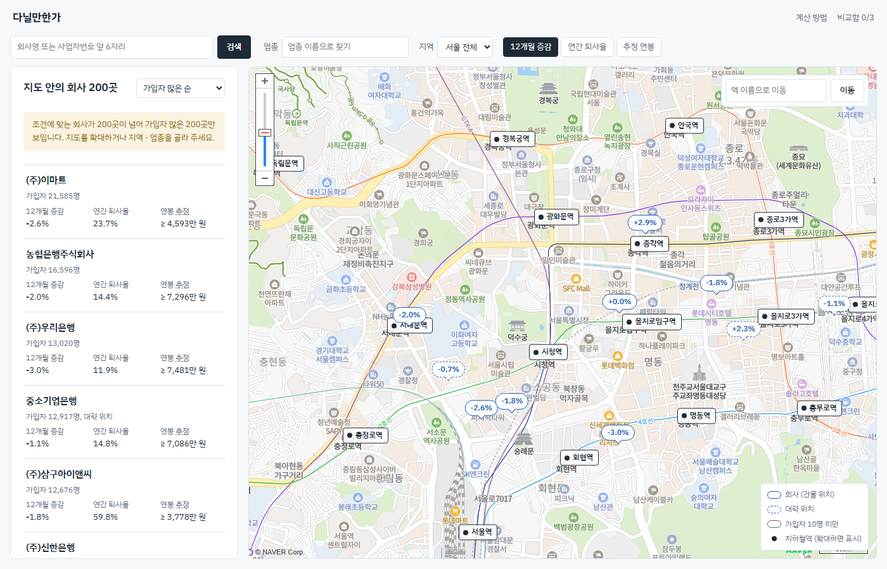
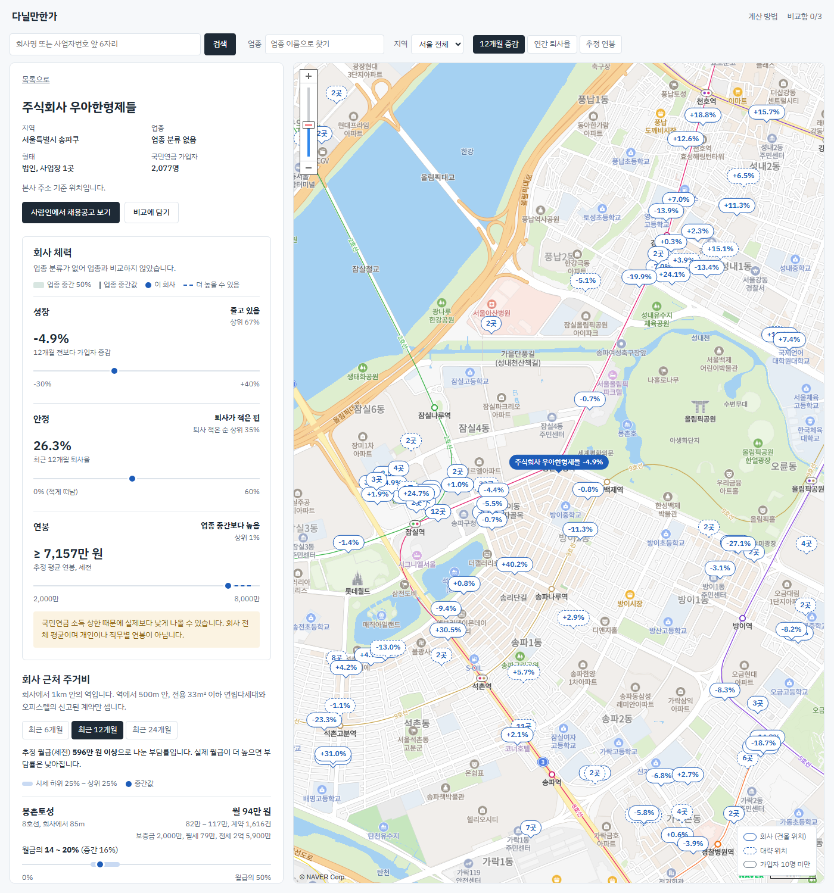
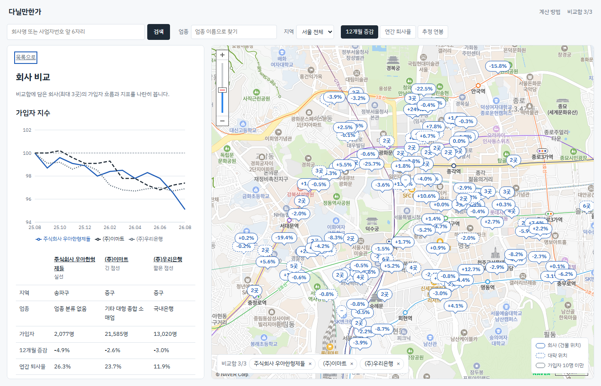
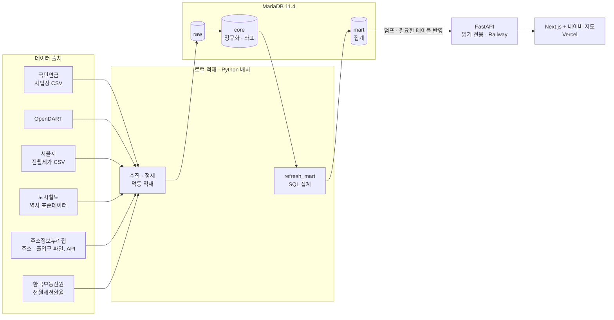

# 다닐만한가 (Worth Joining)

> 공공데이터로 보는 회사 · 채용 · 주거비
> "이 회사, 다닐 만한가?"에 숫자로 답하는 구직자용 웹 서비스

-blue)


국민연금 가입 사업장 데이터와 DART 공시로 **서울특별시 사업장** 회사의 **인원 추이 · 입퇴사율 · 추정 연봉**을 보여줍니다. 회사를 **지도** 위에서 주변 회사와 함께 보고, 최대 3곳을 **비교**하며, 회사 근처 역의 **원룸 전월세 시세와 주거비 부담률**까지 한 화면에서 확인합니다.

**서비스:** https://web-chi-flax-46.vercel.app · **API 문서:** https://api-production-30254.up.railway.app/docs (국민연금 2026-08, 전월세 2026-08 기준)

LLM · RAG 같은 AI 기능 없이 **데이터 수집 → 정제 → DB 모델링 → SQL 분석 → API 제공**의 전 과정을 직접 구현한 프로젝트입니다.

---

## 화면

**지도 메인:** 지도를 움직이면 왼쪽 목록이 지도 범위 안의 회사(가입자 많은 순 최대 200곳)로 바뀝니다. 핀에는 고른 지표(12개월 증감 · 연간 퇴사율 · 추정 연봉)가 보이고, 점선 핀은 도로 · 동 중심의 대략 위치입니다. 위쪽 검색창은 지도와 관계없이 서울 회사 전체에서 찾습니다.



**회사 상세:** 핀이나 목록을 누르면 왼쪽 패널에 상세가 열리고 지도가 그 회사로 이동합니다. 성장 · 안정 · 연봉을 같은 업종의 중간 50% 범위 위에 표시하고, 아래에 회사 근처 역의 원룸 시세와 주거비 부담률, 가입자 추이, 월별 입퇴사, 재무가 이어집니다.



**회사 비교:** 비교함에 담은 최대 3곳의 가입자를 12개월 전 = 100 지수로 겹쳐 보고, 지표를 나란히 비교합니다. `/compare?ids=1,2,3`으로 공유할 수 있습니다.



디자인 가이드: [docs/03_ui_design.md](./docs/03_ui_design.md) · 처음 시안: [docs/mockups/map-home.html](./docs/mockups/map-home.html)

---

## 목차

- [왜 만들었나](#왜-만들었나)
- [주요 기능](#주요-기능)
- [숫자로 본 결과](#숫자로-본-결과)
- [시스템 구조](#시스템-구조)
- [기술 스택](#기술-스택)
- [데이터 출처](#데이터-출처)
- [핵심 지표 계산 방법](#핵심-지표-계산-방법)
- [API](#api)
- [프로젝트 구조](#프로젝트-구조)
- [시작하기](#시작하기)
- [문서](#문서)
- [로드맵](#로드맵)
- [팀](#팀)
- [한계와 면책](#한계와-면책)

---

## 왜 만들었나

구직자가 회사를 판단할 때 쓰는 정보는 대부분 **채용공고**(회사가 쓴 글)와 **익명 리뷰**(개인 경험)입니다.

반면 국민연금공단은 사업장별 가입자 수, 신규 취득자, 상실자, 고지금액을 **매월 공개**하고, DART에는 재무제표가 있으며, 서울시는 전월세 실거래가를 공개합니다. 근거가 될 공식 데이터는 이미 있지만 그대로 쓰기는 어렵습니다.

| 공공데이터의 문제 | 이 프로젝트의 해결 |
|---|---|
| 한 달치 스냅샷이라 추이를 볼 수 없음 | 월별 파일을 누적 적재해 시계열로 만듦 |
| 사업장 단위라 회사 단위로 볼 수 없음 | 사업자번호 + 정규화 상호로 회사 단위 집계 |
| 고지금액을 연봉으로 바꾸려면 보험료율 · 상한을 알아야 함 | 기간별 기준표로 역산하고 한계를 함께 표시 |
| 국민연금, DART 사이에 공통 키가 없음 | 단계별 매칭 규칙과 매칭 신뢰도 기록 |
| 사업장 주소에 건물번호가 없음 | DART 본사 주소 → 상호 검색 → 도로 · 동 중심 순서로 좌표를 정하고 정확도를 표시 |
| 실거래가가 지번 단위라 "역 주변 시세"를 알 수 없음 | 지번 → 건물 출입구 좌표로 바꾼 뒤 역 반경 500m로 집계 |

---

## 주요 기능

| 기능 | 설명 |
|---|---|
| 지도 메인 | 지도 범위 안 회사 목록 · 지표 핀(최대 200곳), 업종 · 지역 필터, 같은 건물은 "N곳"으로 묶음, 대략 위치는 점선 핀 |
| 회사 검색 | 회사명 앞부분 · 사업자번호 앞 6자리 · 업종으로 서울 회사 전체 검색(지도와 무관) |
| 회사 체력 결과표 | 성장 · 안정 · 연봉을 업종 기준 범위 막대(p25 ~ p75, 중간값)와 판정 문장으로 표시 |
| 인원 추이 · 입퇴사 | 월별 가입자 그래프(빈 달은 선을 끊음), 월별 입사율 · 퇴사율 표 |
| 추정 연봉 | 고지금액 역산 하한 추정치(≥)와 계산 방식 |
| 재무 | DART와 연결된 회사의 매출 · 영업이익 · 순이익 · 부채비율 |
| 회사 비교 | 최대 3곳, 12개월 전 = 100 가입자 지수 그래프와 지표 표, URL 공유 |
| 회사 근처 주거비 | 회사에서 1km 안 역(최대 3곳)의 원룸(33㎡ 이하) 환산 월세 · 보증금 · 전세 중앙값과 **주거비 부담률**(6 · 12 · 24개월) |
| 신뢰도 안내 | 표본 부족, 12개월 미만 이력, 최근 자료 없음, 대략 위치, 24개월로 넓힌 시세를 문장으로 표시. 모든 화면에 데이터 기준월 · 출처 |
| 채용공고 바로가기 | 사람인 검색 결과로 이동 |

사람인 API 연계(채용 신호, 공고 연봉 비교)는 API 승인 후 진행합니다([로드맵](#로드맵)).

---

## 숫자로 본 결과

| 항목 | 값 | 자세히 |
|---|---|---|
| 서울 회사 | 126,407곳 (국민연금 13개월, 2025-08 ~ 2026-08) | [profiling.md](./docs/profiling.md) |
| 인원 정확도 | 서울 본사 상장사 5곳 DART 직원 수 대비 **±6% 안** | [validation.md](./docs/validation.md) 3장 |
| 연봉 | 같은 5곳 모두 DART 평균보다 −15 ~ −44% (소득 상한 → 하한 추정으로 표시) | 〃 |
| DART 매칭률 | 서울 본사 상장사 69.1% | [matching.md](./docs/matching.md) |
| 회사 지도 좌표 | 100% (건물 11,961 · 도로 중심 112,867 · 동 중심 1,579) | [validation.md](./docs/validation.md) 1장 |
| 전월세 | 연립다세대 · 오피스텔 계약 443,227건, 건물 좌표 99.92% | validation.md 2장 |
| 응답 시간 (로컬 부하 20명) | 상세 p95 8ms, 검색 p95 6ms, 지도 p95 270ms | [performance.md](./docs/performance.md) |
| mart 갱신 | 회사 지표 · 회사 근처 역 · 역세권 시세 한 트랜잭션 35초 | 〃 |

---

## 시스템 구조



- **3계층 DB:** 원본을 `raw`에 보존하고, `core`에서 정규화하고, `mart`에 미리 집계합니다. API는 `mart`와 작은 조회 테이블만 읽고 요청 시점에 집계하지 않습니다.
- **멱등 적재:** 같은 달 · 같은 파일을 다시 넣어도 결과가 같도록 `INSERT ... ON DUPLICATE KEY UPDATE`, `row_hash`, 파일 체크섬(`ingestion_log`)을 씁니다.
- **로컬 적재 → 배포 반영:** 공공데이터 월 파일은 자동으로 받을 수 없어 로컬에서 적재 · 검증한 뒤 덤프로 Railway DB에 반영합니다([runbook](./docs/runbook.md) 4장).

---

## 기술 스택

| 영역 | 기술 | 용도 |
|---|---|---|
| 수집 · 가공 | Python 3.12, httpx, pandas, openpyxl | API 호출, CSV · XLSX 정제, 인코딩(CP949) 처리 |
| | rapidfuzz | 국민연금 · DART 회사명 유사도 매칭 |
| | pyproj (DLL이 막힌 PC는 같은 공식의 순수 Python 대체) | 좌표계 변환 (UTM-K → WGS84 경위도) |
| DB | MariaDB 11.4 LTS (InnoDB) | 윈도 함수 · CTE, `PERCENTILE_CONT`, 월 파티션, 생성 컬럼, SPATIAL 인덱스 |
| | Alembic | 스키마 마이그레이션 (`0001` ~ `0007`) |
| 백엔드 | FastAPI, uvicorn, Pydantic v2 | REST API, 파라미터 검증, 자동 문서 |
| | SQLAlchemy 2.0 (async) + asyncmy | DB 연결. 통계 쿼리는 `sql/`에 SQL로 작성 |
| 프론트엔드 | Next.js 15 (App Router), React 19, Recharts | 지도 메인 · 상세 · 비교 화면, 그래프 |
| | 네이버 지도 Web Dynamic Map (react-naver-maps) | 지도, 지표 핀 |
| 테스트 | pytest, locust, GitHub Actions 서비스 컨테이너(MariaDB 11.4) | 단위 · SQL 회귀 · API · 성능 테스트 |
| 배포 | Railway (api · mariadb), Vercel (web), GitHub Actions | API · DB, 프론트엔드, CI |

---

## 데이터 출처

| 데이터 | 제공 기관 | 갱신 | 용도 |
|---|---|---|---|
| 국민연금 가입 사업장 내역 | 국민연금공단 (공공데이터포털) | 월 | 인원 추이, 입퇴사율, 추정 연봉. 서울특별시 사업장만 사용 |
| OpenDART 고유번호 · 기업개황 · 주요계정 | 금융감독원 | 수시 | 회사 매칭, 본사 주소, 재무 지표 |
| [서울시 부동산 전월세가 정보](https://data.seoul.go.kr/dataList/OA-21276/S/1/datasetView.do) | 서울특별시 (서울 열린데이터광장) | 일 | 역세권 원룸 시세 (연도별 CSV) |
| 전국도시철도역사정보 표준데이터 | 공공데이터포털 | 연 | 역 위치 |
| 도로명주소 한글 · 도로명주소 출입구 (서울), 검색 · 좌표제공 API | 행정안전부 주소정보누리집 | 월 | 건물 좌표, 도로 · 동 중심, 부족한 주소 검색 |
| 전월세전환율 (서울, 연립다세대) | 한국부동산원 R-ONE | 월 | 보증금 → 월세 환산 |
| 채용공고 검색 API | 사람인 | 일 1회 | (승인 후) 채용 현황 |

**이용 조건 메모**

- **좌표 저장:** 카카오 · 네이버 · 브이월드 지오코딩 결과는 저장할 수 없어, **DB에 저장하는 좌표는 주소정보누리집에서만** 가져옵니다(`geocode_cache.provider`는 모두 `juso`). 네이버 지도는 화면 표시에만 씁니다.
- **사람인 API:** 1일 500회 한도, 출처 표시 필수, 본문 저장 금지 조건을 따릅니다.
- 모든 출처는 서비스 화면 하단과 `/meta/methodology`(계산 방법 화면)에 표시합니다.

---

## 핵심 지표 계산 방법

**추정 평균 연봉** (스냅샷 월 t)

```
추정 연봉 = 고지금액 ÷ 가입자 수 ÷ 보험료율(t) × 12
```

- 보험료율은 2025년까지 9%, 2026년 9.5%이고, 소득 상한은 매년 7월에 갱신됩니다. 두 값 모두 `nps_rate` 기준표로 관리합니다.
- 소득 상한 때문에 고연봉 회사일수록 **낮게 추정**됩니다(DART 대조에서 −15 ~ −44%). 화면에는 "≥ 하한 추정"으로 표시합니다.

**입사율 · 퇴사율**

```
입사율(t) = 신규 취득자(t) ÷ 가입자(t-1)
퇴사율(t) = 상실자(t) ÷ 가입자(t-1)
연간 퇴사율 = 최근 12개월 상실자 합 ÷ 같은 기간 평균 가입자
```

- 직전 달 데이터가 빠졌으면 비율을 계산하지 않습니다(NULL). `LAG`만 쓰지 않고 `PERIOD_ADD(snapshot_ym, -1)`을 확인합니다.
- 가입자 10명 미만은 "표본 부족"으로 업종 비교에서 뺍니다.

**환산 월세와 주거비 부담률**

```
환산 월세 = (월세 + 보증금 × 전월세전환율 ÷ 12) × 10,000원
주거비 부담률 = 역 원룸 환산 월세(p25 · 중앙값 · p75) ÷ (추정 연봉 ÷ 12)
```

- 역에서 500m 안, 전용 33㎡ 이하 연립다세대 · 오피스텔의 신고된 계약, 기준월은 신고 기한(30일)이 지난 달입니다.
- 계약이 20건보다 적으면 24개월로 넓혀 계산하고 따로 표시합니다.

**SQL 예시: 역세권 공간 조인**

```sql
-- 역-건물 쌍을 먼저 만든다. ST_Distance_Sphere만 쓰면 전체 스캔이므로 MBR로 후보를 거른다.
-- 윈도 함수가 있는 쿼리 안에 넣으면 공간 인덱스를 쓰지 않아 쌍을 따로 만든다(docs/explain.md 3장)
INSERT INTO station_building (station_id, building_id)
SELECT st.station_id, b.building_id
FROM station st
STRAIGHT_JOIN building b
  ON MBRContains(ST_Buffer(st.pt, 0.006), b.pt)
 AND ST_Distance_Sphere(st.pt, b.pt) <= 500;
```

---

## API

| 메서드 · 경로 | 설명 |
|---|---|
| `GET /companies?q=&biz_no6=&industry=&region=&sort=&cursor=` | 회사 검색 (키셋 커서) |
| `GET /companies/{id}` | 회사 상세: 지표, 업종 백분위, flags, DART 연결, 지도 위치 |
| `GET /companies/{id}/trend?from_ym=&to_ym=` | 월별 가입자 · 입퇴사율 · 추정 연봉 |
| `GET /companies/{id}/financials` | DART 재무 지표 |
| `GET /companies/{id}/housing?months=6\|12\|24` | 회사 근처 역(최대 3곳) 원룸 시세와 주거비 부담률 |
| `GET /stations?q=&line=&sort=` | 서울 역 309곳과 12개월 시세 |
| `GET /stations/{id}/rent?months=6\|12\|24` | 역 원룸 시세와 전세 비중 |
| `GET /industries?q=` | 업종 목록 |
| `GET /industries/{code}/distribution?metric=` | 업종 내 분포 (p25 · p50 · p75) |
| `GET /compare?ids=1,2,3` | 회사 비교 (최대 3곳, 지수 시계열) |
| `GET /map/companies?industry=&region=&metric=&bbox=` | 지도 핀 (최대 200곳, 좌표 정확도 포함) |
| `GET /meta/methodology` | 계산식 · 한계 · 데이터 기준월 · 출처 |
| `GET /health` | DB 연결, 국민연금 기준월 |

모든 응답에 데이터 기준월(`as_of`)을, 추정치가 들어간 응답에는 `flags`(`salary_is_lower_bound`, `small_sample`, `short_history`, `stale`, `approx_location`, `name_matched`, `period_extended_to_24m`)를 함께 내려줍니다. 계약은 [SPEC.md 8장](./SPEC.md)과 [docs/05_api_spec.md](./docs/05_api_spec.md).

---

## 프로젝트 구조

```
worth-joining/
├─ app/                  # FastAPI (읽기 전용)
│  ├─ routers/           # companies, industries, compare, map_pins, stations, meta
│  ├─ schemas/           # Pydantic 응답 모델
│  ├─ repositories/      # SQL 실행
│  └─ services/          # flags · 계산 방법 문구 · 주거비 부담률
├─ pipeline/             # 로컬 배치
│  ├─ common/            # DB 연결, ingestion_log, 외부 API 클라이언트, 상호 정규화
│  ├─ nps/               # 국민연금: 서울 추출 · 프로파일링 · 적재 · 품질 검사
│  ├─ region/            # 법정동코드 → 시군구
│  ├─ dart/              # 고유번호 · 기업개황 · 매칭 · 재무
│  ├─ geocode/           # juso 지오코더, 주소 · 출입구 파일, 회사 좌표
│  ├─ stations/          # 역 (환승역 묶기)
│  ├─ rent/              # 전월세 적재 · 월 파티션 · 전환율
│  └─ refresh_mart.py    # sql/q1 → q2 → q6 → q5
├─ migrations/           # Alembic 0001 ~ 0007
├─ sql/                  # mart · 지도 · 비교 · 역세권 SQL
├─ web/                  # Next.js (app/(explore): 지도 메인 + 패널)
├─ tests/                # pytest (unit, sql, api, fixtures), perf/locustfile.py
└─ docs/                 # 설계 · 결정 기록 · 프로파일링 · 검증 · 성능 · 운영 · 트러블슈팅
```

---

## 시작하기

**필요한 것:** Python 3.12, Node.js 20+, MariaDB 11.4 (Docker는 선택)

**1. 설치와 환경 변수**

```bash
python -m venv .venv
.venv\Scripts\activate            # macOS · Linux: source .venv/bin/activate
pip install -e ".[dev]"
cp .env.example .env              # DB 계정 비밀번호, API 키를 채운다
```

`.env.example`에 DB 접속 정보(`DATABASE_URL`, `DATABASE_URL_SYNC`, `TEST_DATABASE_URL`, `DB_SSL_VERIFY=false`)와 외부 API 키 항목이 있습니다. API 키는 저장소에 올리지 않습니다. 비어 있는 키의 수집기는 건너뜁니다.

**2. DB와 스키마**

```sql
CREATE DATABASE worth_joining      CHARACTER SET utf8mb4 COLLATE utf8mb4_unicode_ci;
CREATE DATABASE worth_joining_test CHARACTER SET utf8mb4 COLLATE utf8mb4_unicode_ci;
CREATE USER 'wj'@'localhost' IDENTIFIED BY '...';
GRANT ALL PRIVILEGES ON worth_joining.*      TO 'wj'@'localhost';
GRANT ALL PRIVILEGES ON worth_joining_test.* TO 'wj'@'localhost';
```

```bash
python -m alembic upgrade head
```

**3. 데이터**

팀원은 공유 드라이브의 DB 덤프(`worth_joining_YYYYMMDD_*.zip`)를 불러오면 됩니다(zip 안의 `README.txt`). 직접 적재하려면 각 원본을 `data/raw/`에 두고 아래 순서로 실행합니다(파일 위치 · 이름은 [CLAUDE.md](./CLAUDE.md) 명령어와 [runbook](./docs/runbook.md) 4장).

```bash
python -m pipeline.region.load                                # 시군구 이름
python -m pipeline.nps.extract_seoul data/raw/nps/all/*.csv   # 전국 → 서울 추출
python -m pipeline.nps.load --all                             # 13개월 (약 2분)
python -m pipeline.dart.corp_code; python -m pipeline.dart.company_info
python -m pipeline.dart.match; python -m pipeline.dart.financials
python -m pipeline.geocode.company_location                   # 회사 좌표 (본사 · 상호 API + 도로 · 동 파일)
python -m pipeline.stations.load                              # 역
python -m pipeline.rent.seoul --as-of YYYY-MM-DD              # 전월세 (as-of = 자료 받은 날)
python -m pipeline.rent.conversion                            # 전월세전환율
python -m pipeline.refresh_mart                               # mart · 회사 근처 역 · 역세권 시세 (약 35초)
```

**4. 실행**

```bash
python -m uvicorn app.main:app --reload     # http://localhost:8000/docs
cd web && npm install && npm run dev       # http://localhost:3000 (NEXT_PUBLIC_NAVER_MAP_CLIENT_ID 필요)
```

**5. 테스트**

```bash
python -P -m pytest                         # CI와 같은 조건 (Windows는 -P)
ruff check .
cd web && npm run lint && npm run typecheck && npm run build
```

부하 측정은 [tests/perf/locustfile.py](./tests/perf/locustfile.py) 첫 부분, 결과는 [docs/performance.md](./docs/performance.md)에 있습니다.

**6. 배포**

Railway(api · mariadb)와 Vercel(web) 배포, DB 복원, 월 갱신 절차는 [docs/runbook.md](./docs/runbook.md)에 있습니다. 실행 중 막히면 [docs/troubleshooting.md](./docs/troubleshooting.md)를 먼저 봅니다.

---

## 문서

| 문서 | 내용 |
|---|---|
| [SPEC.md](./SPEC.md) | 구현 지시서: 스택, DDL, 계산 규칙, 핵심 SQL, API 계약, 화면, 단계별 완료 조건 |
| [docs/01 ~ 06](./docs/) | 개요, 요구사항, 화면 디자인, DB 설계, API, 아키텍처 |
| [docs/decisions/](./docs/decisions/) | 결정 기록 001 ~ 007 (서울 한정, 좌표 정확도, 지도 메인, Phase 9 범위 등) |
| [docs/profiling.md](./docs/profiling.md) | 국민연금 · 전월세 · 역 원본 프로파일링 |
| [docs/matching.md](./docs/matching.md) | DART 매칭 규칙 · 매칭률 |
| [docs/validation.md](./docs/validation.md) | 좌표 성공률, 회사 5곳 대조, 데이터 품질 지표 |
| [docs/explain.md](./docs/explain.md) · [docs/performance.md](./docs/performance.md) | 실행 계획, 부하 측정, 개선 전후 |
| [docs/runbook.md](./docs/runbook.md) | 배포 · 복원 · 월 갱신 |
| [docs/troubleshooting.md](./docs/troubleshooting.md) | 겪은 문제와 해결 (TS-001 ~) |

---

## 로드맵

> 기간: 2026-10-02 ~ 2026-10-21 (4인 팀)

- [x] **기획 · 설계** (요구사항, SPEC, 화면 시안)
- [x] **회사 체력 MVP** (Phase 0 ~ 7)
  - [x] 데이터 프로파일링, 스키마, 국민연금 13개월 적재 · 품질 검사, mart SQL
  - [x] FastAPI, DART 연동 · 매칭 · 재무, 웹, Railway + Vercel 배포
- [x] **지도 · 비교** (Phase 8): 회사 좌표 100%, 지도 메인 화면, 회사 비교
- [x] **역세권 전월세** (Phase 9, 범위는 decisions/007): 역 · 전월세 적재, 건물 좌표, 역세권 시세, 회사 근처 주거비
- [ ] **마무리** (Phase 11): 검증 · 성능 · 문서 · `v1.0.0`
- [ ] **이후 과제**
  - [ ] 채용 정보 연계 (사람인 API 승인 후, Phase 10)
  - [ ] 전월세 Open API 증분 수집 · 파티션 자동 순환
  - [ ] 역 단독 화면 · 시세 추이, 비교표 주거비 열, 지도 검색창

---

## 팀

4인 팀 프로젝트입니다.

| 트랙 | 담당 | 역할 |
|---|---|---|
| T1 데이터 파이프라인 | [이름](https://github.com/) | 수집 · 정제 · 매칭 · 지오코딩 |
| T2 DB · SQL | [이름](https://github.com/) | 스키마 · mart SQL · 공간 SQL · 성능 |
| T3 백엔드 · 운영 | [이름](https://github.com/) | FastAPI · CI · 배포 |
| T4 프론트엔드 | [이름](https://github.com/) | 화면 · 차트 · 지도 |

협업 규칙(브랜치, PR, 키 관리)은 [SPEC.md 12장](./SPEC.md#12-팀-운영-4인), 요구사항 · 우선순위 · Task는 [docs/02_requirements.md](./docs/02_requirements.md)를 따릅니다.

---

## 한계와 면책

- **추정 연봉:** 국민연금 고지금액에서 역산한 회사 전체 평균의 **하한 추정치**입니다. 개인 · 직무별 연봉이 아니며, 소득 상한 때문에 고연봉 회사일수록 낮게 나옵니다.
- **입퇴사 수치:** 국민연금 신규 · 상실 인원 기준이라 실제 입퇴사와 다를 수 있습니다.
- **공개 범위:** 법인은 가입자 3인 이상, 개인사업장은 10인 이상만 공개되어 소규모 사업장은 빠집니다.
- **지역 범위:** 서울특별시 사업장만 다룹니다. 다른 지역 사업장을 따로 신고한 회사는 서울 인원만 잡히며, 업종 백분위는 서울 사업장끼리 비교한 값입니다.
- **회사 위치:** 국민연금 주소에는 건물번호가 없습니다. DART 본사 주소나 상호 검색으로 건물을 찾은 회사(약 1.2만 곳)만 정확한 위치이고, 나머지는 도로 · 동 중심의 **대략 위치**(본사 대비 중앙값 305 · 567m)입니다. 이때 근처 역과 거리는 참고용입니다.
- **회사 매칭:** 상호 기반 매칭이라 동명 회사를 잘못 연결할 수 있으며, 이름으로 연결한 경우 화면에 표시합니다.
- **전월세 시세:** 신고된 계약 기준이라 현재 매물 가격과 다를 수 있습니다. 아파트와 단독 · 다가구는 제외합니다. 전환율은 서울 연립다세대 값을 오피스텔에도 씁니다.
- 이 서비스의 정보는 참고용이며, 투자 · 법률 · 고용 판단의 근거로 단독 사용해서는 안 됩니다.

---

## 라이선스

- 코드: [MIT License](./LICENSE)
- 데이터: 각 제공 기관의 이용 조건을 따르며, 출처를 서비스 내에 표시합니다.
